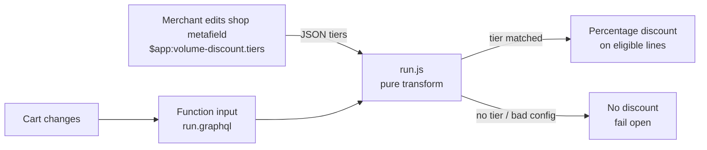
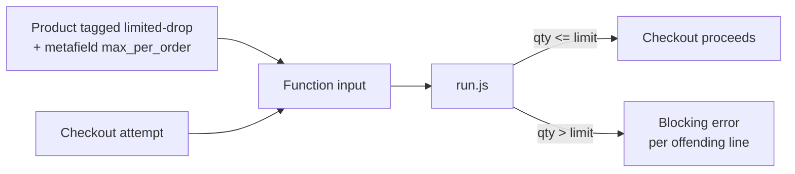
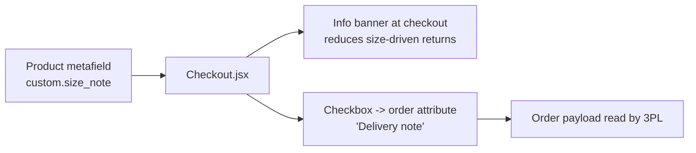

# Architecture & data flow

## Volume discount (Product Discount Function)

Key properties:

- **Pure:** `run(input)` has no I/O; the same input always yields the same output. This is what makes the 100%-coverage test suite possible.
- **Cross-line quantity:** the tier is selected on the sum of eligible quantities in the whole cart — matching how team managers buy assortments.
- **Fail open:** malformed tier JSON → no discount, never an exception. Shopify disables repeatedly-crashing functions; failing open keeps checkout healthy.

## Drop limit (Cart & Checkout Validation Function)

Why a Function and not theme JS: theme-level limits are cosmetic — the cart API
ignores them. A validation function is enforced server-side on **every** path
into checkout (storefront, direct cart links, headless clients).

## Size assist (Checkout UI extension)

Design choices:

- Extension declares exactly one metafield (`custom.size_note`) — checkout UI
  extensions receive only declared metafields, least-privilege by construction.
- No `network_access`, no `api_access`, `block_progress = false`: the extension
  can inform but can never slow down or break checkout.
- Attribute write is optimistic with rollback on error.
